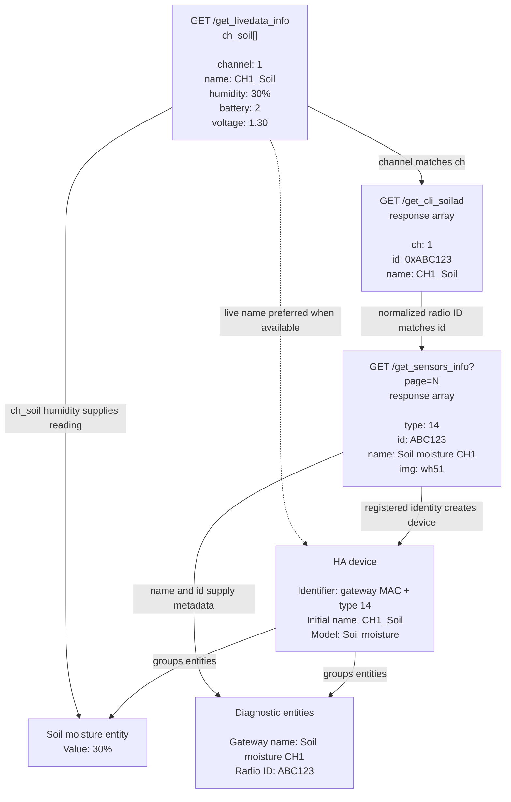

# Ecowitt Atomic

Under development. Do not use.

## Soil moisture data flow

Example values; unrelated response fields are omitted.

Devices are created from registrations, even without live readings. Moisture
entities are created only after an understood reading is observed. New devices
and entities are temporarily restricted to registrations with `img: wh51`.
Battery and voltage are not exposed yet.
